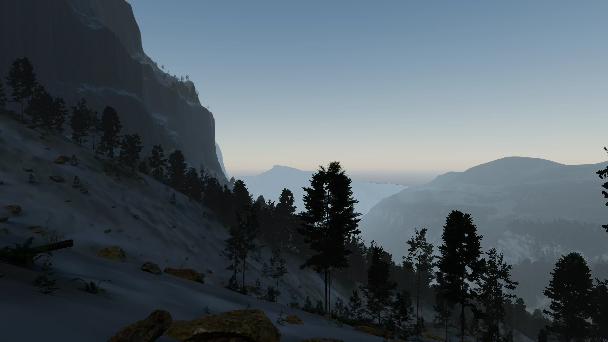
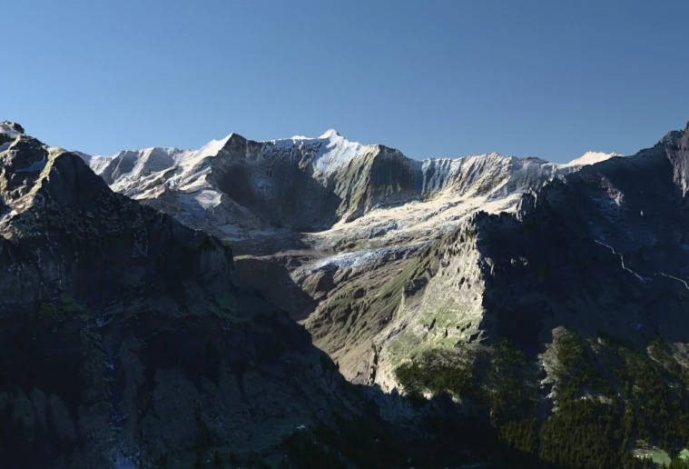
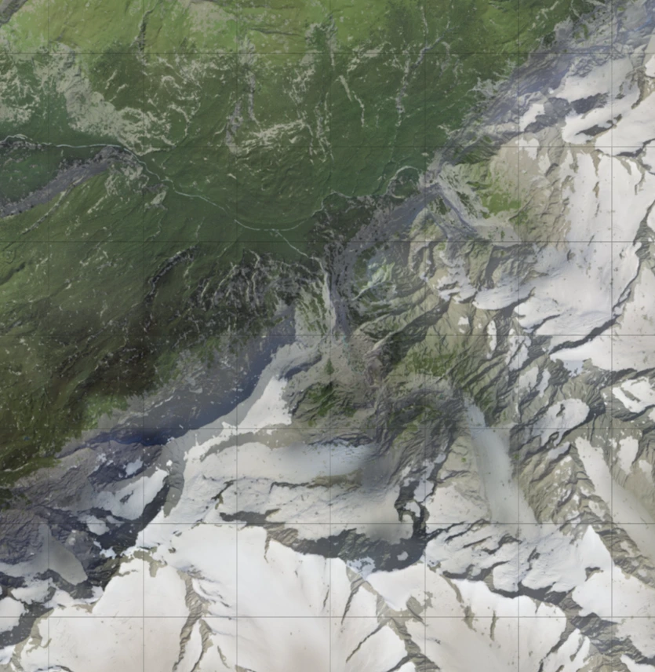
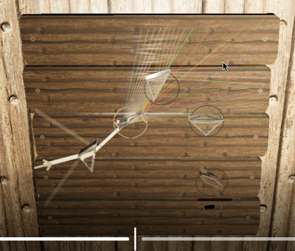

# Monash FYP

A custom game engine in C and Vulkan for rendering a dungeon explorer game.
Terrain is generated with a custom multilayered diffusion model, then populated through procedural mesh placement.

<p align="center">
  
  <br>
  <sub><b>Example 3 — generated terrain with procedural vegetation and rock placement.</b></sub>
</p>

## Terrain generation

```mermaid
flowchart LR
    A["L0 · Procedural world plan<br/>elevation · climate · valleys"] --> B["L1 · Terrain diffusion<br/>32 m"]
    B --> C["Hydrology<br/>flow · channels · erosion"]
    C --> D["L2 · Detail diffusion<br/>4 m"]
    D --> E["L3 · Material classification"]
    E --> F["L4 · Surface diffusion<br/>0.5 m"]
    F --> G["L5 · De-lit albedo diffusion"]
    G --> H["Vulkan renderer<br/>procedural mesh placement"]
```



<table>
  <tr>
    <td width="50%" valign="top">
      
      <br><sub><b>Example 1 — AI-textured Alpine terrain.</b></sub>
    </td>
    <td width="50%" valign="top">
      
      <br><sub><b>Example 2 — top-down diffusion output.</b></sub>
    </td>
  </tr>
</table>

## Dungeon explorer

Procedural dungeons, dynamic lighting, shadows, PBR materials, and interactive lock puzzles run through the same Vulkan renderer.

<p align="center">
  
  <br>
  <sub><b>Example 4 — latest gameplay screenshot: the optical-lock puzzle.</b></sub>
</p>

## Build

```sh
cmake -S . -B build
cmake --build build
TERRAIN_SCENE=dungeon ./build/terrain_renderer
```
